---
hide:
  - navigation
  - toc
---

{ .hero__logo }

# Zaviya { .sr-only }

SteamOS for ARM handhelds, built on the ARM image made for Steam Frame. Not
another skin. I removed what a handheld doesn't need and fixed the rest.

[Install Zaviya](getting-started/install.md){ .md-button .md-button--primary }
[Devices](devices/index.md){ .md-button }
[Downloads](downloads.md){ .md-button }
[:fontawesome-brands-discord: Discord](https://discord.gg/EP53nZYvg){ .md-button }

Formerly known as Unofficial SteamOS ARM Port. An independent community project.
{ .hero__note }

!!! warning "Before you install"

    Installing Zaviya replaces your device's bootloader. Back up your data and
    read the install guide before you start.

## What is in it

<ul class="features" role="list" markdown="1">
  <li markdown="1">
    
:material-layers-triple-outline:

    

      <strong>Base system</strong>
      
The SteamOS ARM image from Steam Frame. Its services crashed on a handheld and the GPU wouldn't clock up, so I turned off what isn't needed and fixed the rest.

    

  </li>
  <li markdown="1">
    
:material-chart-timeline-variant-shimmer:

    

      <strong>Frame generation</strong>
      
Lossless Scaling frame generation, in performance mode on Adreno GPUs. lsfg-vk 2.0 also has an ARM64 build for native ARM games.

    

  </li>
  <li markdown="1">
    
:material-package-variant-closed:

    

      <strong>Zaviya Loadout</strong>
      
The app store. It counts your games per system, shows which emulator to get for the ones nothing plays yet, and installs the starter set for your chip.

    

  </li>
  <li markdown="1">
    
:material-monitor-multiple:

    

      <strong>Bottom screen</strong>
      
On the AYN Thor and AYANEO Pocket DS the bottom screen shows a launcher, game tools, a dashboard with themes, and a trackpad with swipe typing.

    

  </li>
</ul>

## Also included

<ul class="features" role="list" markdown="1">
  <li markdown="1">
    
:material-steam:

    

      <strong>Game Mode and desktop</strong>
      
Game Mode, the Steam client and a KDE desktop, all running natively on ARM.

    

  </li>
  <li markdown="1">
    
:material-gamepad-variant-outline:

    

      <strong>Controller</strong>
      
The handheld's controller shows up as a Steam Deck pad. Decky and the performance overlay come with it.

    

  </li>
  <li markdown="1">
    
:material-update:

    

      <strong>Updates</strong>
      
Updates come from Settings > System, no reflashing. A failed update rolls back.

    

  </li>
  <li markdown="1">
    
:material-plus-box-multiple-outline:

    

      <strong>Add games from files</strong>
      
Windows games, console game files, Linux apps and Android apps go into your Steam library with artwork.

    

  </li>
  <li markdown="1">
    
:material-store-outline:

    

      <strong>Epic, GOG and Amazon</strong>
      
Heroic, as an ARM64 build, installs the libraries. The games launch from Steam with Proton.

    

  </li>
  <li markdown="1">
    
:material-android:

    

      <strong>Android apps</strong>
      
The Play Store works. Each app gets its own title in the library. Zaviya Control has a Restart into Android button.

    

  </li>
  <li markdown="1">
    
:material-cast-connected:

    

      <strong>Remote Play and docking</strong>
      
Steam Remote Play with hardware decoding, and optional PyroWave. Game Mode also runs on an external monitor or dock, sound included.

    

  </li>
  <li markdown="1">
    
:material-sleep:

    

      <strong>Sleep and power</strong>
      
Sleep works on every supported chip, the fan curves are quiet, and the device powers off cleanly before the battery runs flat.

    

  </li>
  <li markdown="1">
    
:material-harddisk:

    

      <strong>Storage</strong>
      
Run it from a microSD card, or install it to internal storage next to Android.

    

  </li>
</ul>

## How to get it

1. Flash the image for your chip to a microSD card (32 GB or bigger).
2. Flash OpenABL, the boot menu. Back up your stock ABL first.
3. Hold Volume Down at power-on, pick your device, set the boot mode to Linux and start it. First boot takes a couple of minutes.

The [install guide](getting-started/install.md) has every step. There's one
image per chip, listed on [Downloads](downloads.md). Tablets are different, they
don't use OpenABL, see the [Lenovo page](devices/lenovo.md).

## Supported devices

-   :material-check-circle:{ .ok } **Snapdragon 8 Elite** · Stable

    AYN Odin 3, KONKR Pocket FIT Elite

-   :material-check-circle:{ .ok } **Snapdragon 8 Gen 3** · Stable

    KONKR Pocket FIT, AYANEO Pocket S2 / S2 Pro

-   :material-check-circle:{ .ok } **Snapdragon 8 Gen 2** · Stable

    AYN Odin 2 / Mini / Portal / Thor, AYANEO Pocket ACE / DMG / DS / EVO /
    S 1K / S 2K, Retroid Pocket 6 / Nova

-   :material-flask-outline:{ .warn } **Snapdragon 865** · Beta

    Retroid Pocket 5 / Flip 2 / Mini / Mini V2, AYN Thor Lite, MANGMI Air Y Pro /
    Pocket Max, AYANEO Pocket MICRO 2

-   :material-flask-outline:{ .warn } **Lenovo Legion Y700** · Testing

    Gen 3 and Gen 4 are in testing. Gen 5 (TB323FU, Snapdragon 8 Elite Gen 5)
    runs from a microSD card and is switched on from Android.
    [Lenovo page](devices/lenovo.md)

The [Supported Devices](devices/index.md) page lists every device by maker.
I only own a Pocket FIT, the rest is tested by the community.

## Community

Questions or install help go to the [Discord](https://discord.gg/EP53nZYvg).
Bugs go to [GitHub issues](https://github.com/hashtagbasit/SteamOS-ARM-Port/issues).
